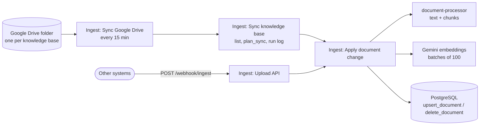

# RAG Knowledge Assistant

> **Work in progress.** Ingestion, hybrid search, the two chat agents and the search API work end to end; the
> evaluation report (and the threshold calibration it drives) comes next.

A retrieval-augmented generation (RAG) engine that serves **several agents from one knowledge store**. Each agent
answers **only from the documents it is allowed to read**, **cites its sources**, and says **"I don't know"** when
the answer is not in them. Documents stay where the company already keeps them (a Google Drive folder) and are
synced incrementally.

Built with **n8n**, **Google Gemini**, **PostgreSQL + pgvector** and **Flyway**, packaged with Docker Compose.

> **Demo data.** The documents belong to Maple Grove Dental Studio, the fictional clinic of
> [whatsapp-ai-receptionist](https://github.com/villasana26enrique/whatsapp-ai-receptionist). Everything is made up.

## Demo setup: one clinic, two knowledge bases, two agents

| Knowledge base | Contents | Read by |
|---|---|---|
| `patient-handbook` | Aftercare, insurance and payments, cancellation policy, new patient FAQ, emergencies | Patient assistant, Staff assistant |
| `staff-handbook` | Time off, shifts, sterilization protocol, onboarding | Staff assistant |

A patient asking how many vacation days the staff get is told the assistant does not know — the answer exists,
but not in a base the patient assistant can read.

## Agents

| Agent | Reads | Try it |
|---|---|---|
| Patient assistant | `patient-handbook` | Chat page: `http://localhost:5679/webhook/4f8c2a91-7d3e-4b6a-9e15-2c7d8a0f1b34/chat` |
| Staff assistant | `patient-handbook`, `staff-handbook` | Chat page: `http://localhost:5679/webhook/9a3d6e72-1c5b-4f80-8b2e-6d4a1f9c7e05/chat` |

Both are the same small workflow (n8n AI Agent + Gemini + Postgres chat memory + one tool) with a different prompt.
The tool, `search_clinic_documents`, calls the sub-workflow *Tool: Search knowledge*:

- **The agent is fixed by the workflow, never by the model**: the LLM only writes the query, so no user can talk it
  into searching as another agent. Row level security does the rest.
- **The query is rewritten in English** by the model, whatever the user's language, which helps full-text search
  and similarity; the agent still answers in the user's language.
- Each passage comes with a ready-to-cite source, e.g. `Aftercare Guide, Tooth Extraction > Eating and drinking, p. 1`.
- The prompt: answer only from the passages, cite them, and say "I don't know" (with who to ask) when they do not
  answer the question.
- **Every answer is stored next to the searches that produced it** (`query_log.answer`, by conversation), so a bad
  answer can be traced to the passages the agent saw.

## Search API (for other agents)

Any other agent — for example the WhatsApp receptionist — can use the same retrieval over HTTP:

```bash
curl -H "X-API-Key: $KEY" -H "Content-Type: application/json"      -d '{"query": "How long should I avoid coffee after whitening?"}' http://localhost:5679/webhook/search
# {"ok":true,"answerable":true,"message":"...","query_id":12,
#  "passages":[{"source":"Aftercare Guide, Teeth Whitening > The first 48 hours, p. 2","text":"...","similarity":0.78}]}
```

**The key decides the agent**: each key belongs to one agent and the request cannot change it, so a leaked key of
the receptionist never reaches the staff handbook. Keys are created by the owner and stored only as a SHA-256 hash:

```bash
./scripts/create-api-key.sh patient-assistant "WhatsApp receptionist"   # prints the key once
```

## Design decisions

- **Isolation enforced by PostgreSQL.** n8n connects with an unprivileged role; row level security only returns
  chunks of the bases assigned to the agent. A query that forgets its filter returns nothing, not someone else's data.
- **Hybrid search.** Vector similarity understands meaning ("my tooth hurts after the extraction"); full-text search
  catches exact terms ("Delta Dental PPO"). Both lists are fused with Reciprocal Rank Fusion, in SQL.
- **"I don't know" is a feature.** Below a similarity threshold the search returns no passages and tells the agent
  to say so. The threshold is calibrated with the evaluation set, not guessed.
- **Incremental, atomic ingestion.** Only new, changed or renamed files are processed (modified date and title),
  and only those whose text or title really changed are embedded (content hash); files removed from the source are
  removed from the index; a document's chunks are replaced in one transaction, so searches never see half a document.
- **Least privilege for Drive.** A Google service account with read-only access to the shared folders only — no
  personal OAuth grant that expires or sees the whole Drive.
- **One bad file never stops a sync.** It is recorded with its error and the run ends as `partial`.
- **Every search is logged** with its candidates and scores, for debugging and to find new evaluation cases.

## Database

Schema `knowledge`: `knowledge_bases`, `agents`, `agent_knowledge_bases`, `documents`, `chunks`
(`vector(768)` + generated `tsvector`, HNSW and GIN indexes), `ingestion_runs`, `query_log`.

| Function | Purpose |
|---|---|
| `plan_sync` | Compare a source listing with the stored documents: what to process, what to delete |
| `skip_if_unchanged` | Same text and title: skip the embeddings |
| `upsert_document` | Store a document and replace its chunks atomically |
| `delete_document` | Remove a document from the index (the row is kept for audit) |
| `search_knowledge` | Hybrid search for an agent, with threshold and logging |
| `start_ingestion_run` / `finish_ingestion_run` | Record each sync |
| `record_answer`, `purge_old_logs` | Answer logging and retention |

## Document processor

`document-processor/` is a small internal service (Python standard library HTTP server + `pypdf` +
`python-docx`) that turns a file into chunks ready to embed. It calls no model and holds no secrets, so the same
file always gives the same chunks.

```
POST /extract-and-chunk?title=Aftercare%20Guide[&max_tokens=500]     body = the file, Content-Type = its type
```

- **Formats**: PDF, DOCX (Google Docs are exported as DOCX), Markdown and plain text.
- **Structure first**: DOCX and Markdown headings, and in PDFs the lines set in a larger font, become the section
  path. Lists and tables are kept as text.
- **Chunks of about 500 tokens with 15% overlap**, never mixing two sections. A long paragraph is split by sentences,
  a huge sentence by words.
- **Each chunk is labeled with where it comes from** — `Aftercare Guide > Tooth Extraction > Eating and drinking` —
  and that label is embedded with the text (`embedding_text`).
- **PDF clean-up**: lines rejoined into paragraphs, hyphenated words rejoined, page numbers dropped, paragraphs
  that run onto the next page rejoined; chunks keep their page range for citations.
- **`content_hash`** is computed on the extracted text, not on the file, so re-saving a file without changing it
  is not re-embedded.
- Not supported (yet): scanned PDFs (no OCR) and text inside images.

## Ingestion



| Workflow | What it does |
|---|---|
| `Ingest: Sync Google Drive` | Every 15 minutes (or *Run now*): syncs each knowledge base that has a Drive folder |
| `Ingest: Sync knowledge base` | Lists the folder, asks `plan_sync` what changed, applies each change, records the run in `ingestion_runs` |
| `Ingest: Apply document change` | One file: download (Google Docs exported as DOCX) → `document-processor` → skip if unchanged → embeddings (`gemini-embedding-001`, 768 dimensions, `RETRIEVAL_DOCUMENT`) → `upsert_document`; or `delete_document` |
| `Ingest: Upload API` | `POST /webhook/ingest` for systems that do not use Drive |

Upload API (`multipart/form-data`, `X-API-Key` header = `INGEST_API_KEY`):

```bash
curl -H "X-API-Key: $INGEST_API_KEY" -F knowledge_base=patient-handbook -F source_id=aftercare-v1      -F "file=@aftercare.pdf" http://localhost:5679/webhook/ingest
# {"ok":true,"status":"added","source_id":"aftercare-v1","title":"aftercare","chunk_count":4}
```

`status` is `added`, `updated`, `unchanged` or `failed` (HTTP 422, with `error`). `title` defaults to the file
name, `source_id` too: sending the same `source_id` again replaces that document.

## Demo documents

`demo/documents/` holds the source text of the eight demo documents (fictional, consistent with the receptionist's
clinic data). `demo/build_documents.py` turns them into the formats a real clinic would have — PDF (with page
numbers), DOCX (with tables) and Google Docs — so every extraction path is exercised:

| Knowledge base | Document | Format |
|---|---|---|
| patient-handbook | Aftercare Guide | PDF (2 pages) |
| patient-handbook | Dental Emergencies | PDF |
| patient-handbook | Insurance and Payments | DOCX |
| patient-handbook | Cancellation and Missed Appointments Policy | Google Doc |
| patient-handbook | New Patient FAQ | Google Doc |
| staff-handbook | Time Off and Scheduling Policy | DOCX |
| staff-handbook | Sterilization and Infection Control Protocol | PDF |
| staff-handbook | New Staff Onboarding Checklist | Google Doc |

```bash
docker build --target test -t rag-document-tools document-processor
docker run --rm -v "$PWD/demo:/demo" rag-document-tools python /demo/build_documents.py   # -> demo/build/
```

Upload `demo/build/<knowledge base>/` to the matching Drive folder (the `.md` files as Google Docs).

## Getting started

### 1. Google Drive access (service account)

1. In Google Cloud Console, enable the **Google Drive API** and create a service account with **no roles**.
2. Create a **JSON key** for it and keep the file **outside the repository**; `.env` only holds its path
   (`GOOGLE_SERVICE_ACCOUNT_KEY_FILE`).
3. Share each knowledge base's Drive folder with the service account's email as **Viewer**, and put the folder ids
   in `.env` (`DRIVE_FOLDER_PATIENT_HANDBOOK`, `DRIVE_FOLDER_STAFF_HANDBOOK`).

### 2. Configure, start and set up

```bash
cp .env.example .env        # fill in every value
docker compose up -d        # PostgreSQL + Flyway migrations, document-processor and n8n (http://localhost:5679)
./scripts/setup-n8n.sh      # credentials, Drive folders, workflows and publishing
```

`setup-n8n.sh` creates the n8n credentials from `.env` with the ids the workflows reference (Postgres as `rag_app`,
the Drive service account, Gemini, the upload API key), links each knowledge base to its Drive folder, imports and
publishes the workflows. n8n stores the credentials encrypted with `N8N_ENCRYPTION_KEY`; after the setup it does not
read the key file again. Then open n8n, create the owner account and run *Ingest: Sync Google Drive*.

### Tests

```bash
docker build --target test document-processor
```

Runs the processor's `pytest` suite inside the image (the build fails if a test fails). The tests build real PDF,
DOCX and Markdown files in memory and also call the HTTP server.


```bash
docker compose exec -T postgres sh -c 'psql -U "$POSTGRES_USER" -d "$POSTGRES_DB" -v ON_ERROR_STOP=1' < database/tests/knowledge_tests.sql
```

They run as the application role inside a rolled-back transaction and print `ALL TESTS PASSED`. Covered:
ingestion and validation, updates and versioning, change detection, sync planning (including the guard against an
empty listing), deletion and restore, hybrid ranking, the "I don't know" threshold, isolation between bases
(searches, plain queries and writes), logging, ingestion runs and retention.

## Known limitations

- Only PDF, DOCX, Google Docs, Markdown and plain text are synced; other files in the folders are ignored.
  Scanned PDFs (no text layer) fail with a clear error.
- A file that cannot be processed is retried on every sync until it is fixed or removed.
- An empty folder listing never deletes the whole knowledge base (it is far more likely a failed listing); the run
  fails instead. Remove the last documents with `delete_document` if that is really intended.
- Up to 1,000 files per folder (no paging yet); subfolders are not synced.
- Permissions are per knowledge base, not per document or user.
- On Gemini's free tier, replies can take from a few seconds to over a minute when the models are under high demand
  (503 errors are retried; after three failures the user gets an apology, not an error). A paid tier fixes this.
- The "I don't know" threshold (0.6) is a placeholder until the evaluation set calibrates it: an unrelated question
  can still get loosely related passages, and only the prompt keeps the agent from using them.

## License

MIT
