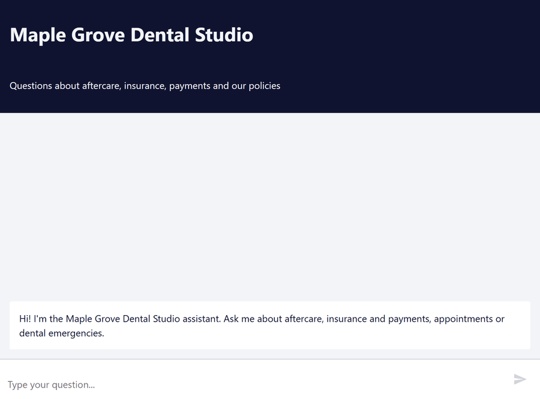
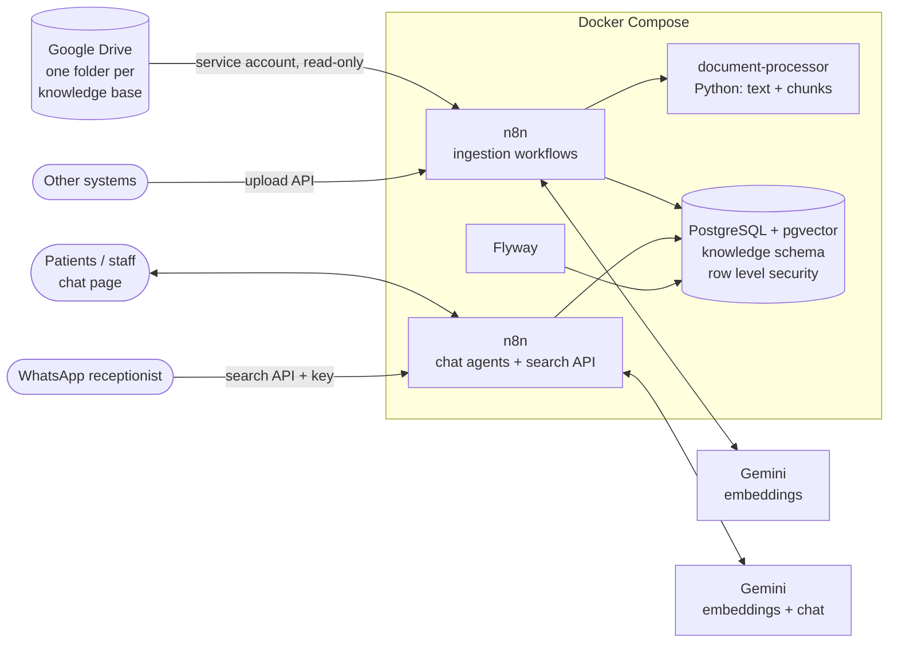

# RAG Knowledge Assistant

A retrieval-augmented generation (RAG) engine that serves **several agents from one knowledge store**. Each agent
answers **only from the documents it is allowed to read**, **cites its sources**, and says **"I don't know"** when
the answer is not in them. Documents stay where the company already keeps them — a Google Drive folder — and are
synced incrementally.

Built with **n8n**, **Google Gemini**, **PostgreSQL + pgvector** and **Flyway**, packaged with Docker Compose.

> **Demo data.** The documents belong to Maple Grove Dental Studio, the fictional clinic of
> [whatsapp-ai-receptionist](https://github.com/villasana26enrique/whatsapp-ai-receptionist), which uses this
> project's search API to answer patients on WhatsApp. Everything is made up.

<p align="center">
  
</p>

*The patient assistant answers from the clinic's documents and cites the document, section and page; asked about
the staff's vacation days — an answer that exists only in the staff handbook — it says it does not know. It also
answers in the patient's language (Spanish questions get Spanish answers from the English documents).*

## Highlights

- **Grounded answers with citations** — `(Source: Aftercare Guide, Teeth Whitening > The first 48 hours, p. 2)`.
- **"I don't know" instead of guessing**, measured: 7/7 out-of-scope questions refused, 0 unsupported claims in 34 answers.
- **Isolation enforced by PostgreSQL row level security**: the patient agent can never read the staff handbook,
  even through a buggy query.
- **Hybrid search** (vectors + full text, Reciprocal Rank Fusion) written in SQL.
- **Incremental Google Drive sync**: new, changed, renamed and deleted files, one bad file never stops a sync.
- **Real documents**: PDF (headings from font size and weight, page numbers for citations), DOCX with tables,
  Google Docs.
- **Evaluation suite** with an LLM judge that was itself tested before being trusted.
- **Search API with per-agent keys**, used by a separate WhatsApp receptionist.

## Architecture



## Demo: one clinic, two knowledge bases, two agents

| Knowledge base | Contents | Read by |
|---|---|---|
| `patient-handbook` | Aftercare, insurance and payments, cancellation policy, new patient FAQ, emergencies | Patient assistant, Staff assistant |
| `staff-handbook` | Time off, shifts, sterilization protocol, onboarding | Staff assistant |

A patient asking how many vacation days the staff get is told the assistant does not know — the answer exists,
but not in a base the patient assistant can read.

## Evaluation

Every change is measured against an evaluation set, not judged by a few chats. `evals/cases.json` has
34 questions: answerable ones (single document, several documents, in Spanish, the staff agent reading the
patient handbook) and ones that **must** be refused (out of scope, or in the other agent's knowledge base).
`python evals/run_evals.py` asks the real system, and an LLM judge scores every answer against a reference and
against the documents the agent is allowed to read. Latest run ([full report](evals/report.md)):

| Metric | Result |
|---|---|
| Expected document in the top 5 passages | 27/27 (100%) |
| Correct answers (judge ≥ 4/5) | 27/27 (100%), mean 4.94/5 |
| Answers with no claim outside the documents | 34/34 (100%) |
| Says "I don't know" when it should (out of scope, other agent's documents) | 7/7 (100%) |
| Says "I don't know" when it should not | 0/27 |
| Staff passages returned to the patient agent | 0 |
| Median response time (Gemini free tier) | 16 s |

The judge was tested before trusting it: fed a wrong number, invented advice, a correct answer with one invented
fee, an isolation breach and a false refusal, it caught all five.

**What the numbers say about the threshold.** No similarity threshold separates relevant from irrelevant questions
on its own: "How long after a cleaning can I eat sweets?" (not in the documents) scores 0.66, while "Do you accept
Medicaid?" (answered in the documents) scores 0.65. A threshold high enough to block the first would refuse the
second. So the design has two layers: a permissive threshold (0.6, per agent in `knowledge.agents.min_similarity`)
drops clearly unrelated questions, and the agent's prompt refuses when the passages it gets do not answer the
exact question. With both, every out-of-scope question was refused and no answer contained an unsupported claim.

The set is small and written from the same documents, so these numbers are optimistic; its value is catching
regressions. Every bug found in a real conversation becomes a new case.

## Agents

| Agent | Reads | Chat page (after setup) |
|---|---|---|
| Patient assistant | `patient-handbook` | `http://localhost:5679/webhook/4f8c2a91-7d3e-4b6a-9e15-2c7d8a0f1b34/chat` |
| Staff assistant | `patient-handbook`, `staff-handbook` | `http://localhost:5679/webhook/9a3d6e72-1c5b-4f80-8b2e-6d4a1f9c7e05/chat` |

Both are the same small workflow (n8n AI Agent + Gemini + Postgres chat memory + one tool) with a different prompt.
The tool, `search_clinic_documents`, calls the sub-workflow *Tool: Search knowledge*:

- **The agent is fixed by the workflow, never by the model**: the LLM only writes the query, so no user can talk it
  into searching as another agent. Row level security does the rest.
- **The query is rewritten in English** by the model, whatever the user's language, which helps full-text search
  and similarity; the agent still answers in the user's language.
- Each passage comes with a ready-to-cite source, e.g. `Aftercare Guide, Tooth Extraction > Eating and drinking, p. 1`.
- The prompt: answer only from the passages, cite them, and say "I don't know" (with who to ask) when they do not
  answer the question.
- **Never silent**: Gemini errors are retried, then a fallback model answers; if both fail the user gets an apology
  in their language.
- **Every answer is stored next to the searches that produced it** (`query_log.answer`, by conversation), so a bad
  answer can be traced to the passages the agent saw.

## Search API (for other agents)

Any other agent — for example the WhatsApp receptionist — can use the same retrieval over HTTP:

```bash
curl -H "X-API-Key: $KEY" -H "Content-Type: application/json" \
     -d '{"query": "How long should I avoid coffee after whitening?"}' http://localhost:5679/webhook/search
# {"ok":true,"answerable":true,"top_similarity":0.7695,"min_similarity":0.6,"query_id":12,
#  "passages":[{"source":"Aftercare Guide, Teeth Whitening > The first 48 hours, p. 2","text":"...","similarity":0.7695}]}
```

**The key decides the agent**: each key belongs to one agent and the request cannot change it, so a leaked key of
the receptionist never reaches the staff handbook. Keys are created by the owner and stored only as a SHA-256 hash:

```bash
./scripts/create-api-key.sh patient-assistant "WhatsApp receptionist"   # prints the key once
```

## Design decisions

- **Isolation enforced by PostgreSQL.** n8n connects with an unprivileged role; row level security only returns
  chunks of the bases assigned to the agent. A query that forgets its filter returns nothing, not someone else's data.
- **Hybrid search.** Vector similarity understands meaning ("my tooth hurts after the extraction"); full-text search
  catches exact terms ("Delta Dental PPO"). Both lists are fused with Reciprocal Rank Fusion, in SQL.
- **"I don't know" is a feature**, in two layers: a per-agent similarity threshold and a prompt that refuses
  passages that do not answer the question (see [Evaluation](#evaluation)).
- **Incremental, atomic ingestion.** Only new, changed or renamed files are processed (modified date and title),
  and only those whose text or title really changed are embedded (content hash); files removed from the source are
  removed from the index; a document's chunks are replaced in one transaction, so searches never see half a document.
- **Least privilege for Drive.** A Google service account with read-only access to the shared folders only — no
  personal OAuth grant that expires or sees the whole Drive.
- **One bad file never stops a sync.** It is recorded with its error and the run ends as `partial`.
- **Deterministic processing.** Extraction and chunking call no model, so the same file always gives the same
  chunks and the tests need no network.
- **Every search is logged** with its candidates and scores, for debugging and to find new evaluation cases;
  questions and conversations are purged after 90 days.

## Ingestion


| Workflow | What it does |
|---|---|
| `Ingest: Sync Google Drive` | Every 15 minutes (or *Run now*): syncs each knowledge base that has a Drive folder |
| `Ingest: Sync knowledge base` | Lists the folder, asks `plan_sync` what changed, applies each change, records the run in `ingestion_runs` |
| `Ingest: Apply document change` | One file: download (Google Docs exported as DOCX) → `document-processor` → skip if unchanged → embeddings (`gemini-embedding-001`, 768 dimensions, `RETRIEVAL_DOCUMENT`) → `upsert_document`; or `delete_document` |
| `Ingest: Upload API` | `POST /webhook/ingest` for systems that do not use Drive |

Upload API (`multipart/form-data`, `X-API-Key` header = `INGEST_API_KEY`):

```bash
curl -H "X-API-Key: $INGEST_API_KEY" -F knowledge_base=patient-handbook -F source_id=aftercare-v1 \
     -F "file=@aftercare.pdf" http://localhost:5679/webhook/ingest
# {"ok":true,"status":"added","source_id":"aftercare-v1","title":"aftercare","chunk_count":4}
```

`status` is `added`, `updated`, `unchanged` or `failed` (HTTP 422, with `error`). `title` defaults to the file
name, `source_id` too: sending the same `source_id` again replaces that document.

## Document processor

`document-processor/` is a small internal service (Python standard library HTTP server + `pypdf` +
`python-docx`) that turns a file into chunks ready to embed.

```
POST /extract-and-chunk?title=Aftercare%20Guide[&max_tokens=500]     body = the file, Content-Type = its type
```

- **Formats**: PDF, DOCX (Google Docs are exported as DOCX), Markdown and plain text.
- **Structure first**: DOCX and Markdown headings — and in PDFs the lines set in a larger font, or short lines
  entirely in bold — become the section path. Lists and tables are kept as text.
- **Chunks of about 500 tokens with 15% overlap**, never mixing two sections. A long paragraph is split by
  sentences, a huge sentence by words.
- **Each chunk is labeled with where it comes from** — `Aftercare Guide > Tooth Extraction > Eating and drinking` —
  and that label is embedded with the text.
- **PDF clean-up**: lines rejoined into paragraphs, hyphenated words rejoined, page numbers dropped, paragraphs
  that run onto the next page rejoined; chunks keep their page range for citations.
- **`content_hash`** is computed on the extracted text, not on the file, so re-saving a file without changing it
  is not re-embedded.

## Database

Schema `knowledge`: `knowledge_bases`, `agents` (with each agent's `min_similarity`), `agent_knowledge_bases`,
`documents`, `chunks` (`vector(768)` + generated `tsvector`, HNSW and GIN indexes, page range), `ingestion_runs`,
`query_log`, `agent_api_keys`. Chat memory lives in its own schema, `chat_memory`.

| Function | Purpose |
|---|---|
| `plan_sync` | Compare a source listing with the stored documents: what to process, what to delete |
| `skip_if_unchanged` | Same text and title: skip the embeddings |
| `upsert_document` / `delete_document` | Store a document and replace its chunks atomically / remove it from the index (the row is kept for audit) |
| `search_knowledge` | Hybrid search for an agent, with threshold and logging |
| `start_ingestion_run` / `finish_ingestion_run` | Record each sync |
| `authenticate_api_key`, `create_api_key`, `revoke_api_key` | Search API keys (create and revoke: owner only) |
| `record_session_answer`, `record_answer`, `purge_old_logs` | Answer logging and retention |

## Tech stack

| Piece | Technology |
|---|---|
| Orchestration, agents, APIs | n8n 2.40 (AI Agent node, sub-workflows, webhooks, hosted chat) |
| Embeddings and chat | Google Gemini (`gemini-embedding-001`; `gemini-3.1-flash-lite` with `gemini-flash-lite-latest` as fallback) |
| Vector store and search | PostgreSQL 16 + pgvector (HNSW), full-text search, row level security, PL/pgSQL |
| Migrations | Flyway (versioned `V__` + repeatable `R__`) |
| Document processing | Python 3.12, `pypdf`, `python-docx`, `pytest` |
| Document source | Google Drive API with a service account |
| Evaluation | Python (standard library) + Gemini as judge |
| Infrastructure | Docker Compose |

## Repository layout

```
├── docker-compose.yml
├── .env.example
├── database/
│   ├── migrations/      V1 schema · V2 demo bases and agents · V3 page ranges · V4 API keys and chat memory
│   ├── functions/       R__ repeatable migrations: ingestion, search, row level security, API keys, retention
│   └── tests/           knowledge_tests.sql (runs as the application role)
├── document-processor/  Python service: extraction, chunking, pytest suite
├── n8n/
│   ├── workflows/       ingestion, search tool, chat agents, search API, maintenance (exported JSON)
│   └── scripts/         helpers for setup and export
├── scripts/             setup-n8n.sh · reload-workflows.sh · export-workflows.sh · create-api-key.sh
├── evals/               cases.json · run_evals.py · report.md
├── demo/                source of the eight demo documents and the script that builds PDF/DOCX
└── postgres/Dockerfile  PostgreSQL + pgvector
```

## Getting started

### Prerequisites

- Docker with Docker Compose.
- A [Google AI Studio](https://aistudio.google.com/) API key (Gemini).
- A Google Cloud project with the Google Drive API enabled, for the service account below.

### 1. Google Drive access (service account)

1. In Google Cloud Console, enable the **Google Drive API** and create a service account with **no roles**.
2. Create a **JSON key** for it and keep the file **outside the repository**; `.env` only holds its path
   (`GOOGLE_SERVICE_ACCOUNT_KEY_FILE`).
3. Share each knowledge base's Drive folder with the service account's email as **Viewer**, and put the folder ids
   in `.env` (`DRIVE_FOLDER_PATIENT_HANDBOOK`, `DRIVE_FOLDER_STAFF_HANDBOOK`).
4. Put the demo documents in the folders (see [Demo documents](#demo-documents)).

### 2. Configure, start and set up

```bash
cp .env.example .env        # fill in every value
docker compose up -d        # PostgreSQL + Flyway migrations, document-processor and n8n (http://localhost:5679)
./scripts/setup-n8n.sh      # credentials, Drive folders, workflows and publishing
```

`setup-n8n.sh` creates the n8n credentials from `.env` with the ids the workflows reference (Postgres as `rag_app`,
the Drive service account, Gemini, the upload API key), links each knowledge base to its Drive folder, and imports
and publishes every workflow. n8n stores the credentials encrypted with `N8N_ENCRYPTION_KEY`; after the setup it does
not read the key file again. Then open n8n, create the owner account and run *Ingest: Sync Google Drive* (or wait
15 minutes), and open the chat pages listed under [Agents](#agents).

Verified by installing from scratch on empty volumes (a separate Compose project): ten migrations applied, four
credentials and nine workflows created, the eight demo documents synced from Drive, search and chat answering with
sources, and the database tests passing.

### 3. Search API keys and evaluations

```bash
./scripts/create-api-key.sh patient-assistant "evals"   # put it in .env as EVALS_PATIENT_API_KEY
./scripts/create-api-key.sh staff-assistant "evals"     # ... and EVALS_STAFF_API_KEY
python evals/run_evals.py                               # writes evals/report.md
```

### Tests

```bash
docker build --target test document-processor
docker compose exec -T postgres sh -c 'psql -U "$POSTGRES_USER" -d "$POSTGRES_DB" -v ON_ERROR_STOP=1' < database/tests/knowledge_tests.sql
```

The first runs the processor's `pytest` suite inside the image (the build fails if a test fails); the tests build
real PDF, DOCX and Markdown files in memory and also call the HTTP server. The second runs the database tests as the
application role inside a rolled-back transaction and prints `ALL TESTS PASSED`: ingestion and validation, updates
and versioning, change detection, sync planning (including the guard against an empty listing), deletion and
restore, hybrid ranking, the "I don't know" threshold, isolation between bases (searches, plain queries and writes),
API keys, logging, ingestion runs and retention. Both suites were checked by breaking the rules on purpose
(opening a row level security policy, disabling the threshold, removing heading detection) and seeing them fail.

## Demo documents

`demo/documents/` holds the source text of the eight demo documents (fictional, consistent with the receptionist's
clinic data). `demo/build_documents.py` turns them into the formats a real clinic would have — PDF (with page
numbers), DOCX (with tables) and Google Docs — so every extraction path is exercised:

| Knowledge base | Document | Format |
|---|---|---|
| patient-handbook | Aftercare Guide | PDF (2 pages) |
| patient-handbook | Dental Emergencies | PDF |
| patient-handbook | Insurance and Payments | DOCX |
| patient-handbook | Cancellation and Missed Appointments Policy | Google Doc |
| patient-handbook | New Patient FAQ | Google Doc |
| staff-handbook | Time Off and Scheduling Policy | DOCX |
| staff-handbook | Sterilization and Infection Control Protocol | PDF |
| staff-handbook | New Staff Onboarding Checklist | Google Doc |

```bash
docker build --target test -t rag-document-tools document-processor
docker run --rm -v "$PWD/demo:/demo" rag-document-tools python /demo/build_documents.py   # -> demo/build/
```

Upload `demo/build/<knowledge base>/` to the matching Drive folder (the `.md` files as Google Docs).

## Deploying for a client

The same commands work on any Linux server with Docker. Each client gets its own installation (its own database
and keys), which keeps their documents physically separate. Before a real deployment:

- **HTTPS** in front of n8n (Caddy, Traefik or nginx), and PostgreSQL never published to the internet.
- **The service account key** in a fixed path outside the repository (e.g. `/etc/rag-knowledge-assistant/`,
  readable only by the user running the stack); rotate it by creating a new key, replacing the file, running
  `setup-n8n.sh` and deleting the old key in Google Cloud.
- **Backups** of the database and the n8n volume; `N8N_ENCRYPTION_KEY` and the key file in a secrets manager.
- **A paid Gemini tier** (or another model: the chat model is one node), which removes the free tier's delays.

## Next steps

- Define each client's knowledge bases and agents in a configuration file applied by the setup (today they come
  from the demo migration).
- Accept an external PostgreSQL (host, port and SSL mode from `.env`; the bundled database as a development profile).
- Per-document and per-user permissions, mirrored from the source.
- OCR for scanned PDFs, a reranker after the hybrid search, more connectors (SharePoint, Notion), paging for
  folders with more than 1,000 files.

## Known limitations

- Only PDF, DOCX, Google Docs, Markdown and plain text are synced; other files in the folders are ignored.
  Scanned PDFs (no text layer) fail with a clear error.
- A file that cannot be processed is retried on every sync until it is fixed or removed.
- An empty folder listing never deletes the whole knowledge base (it is far more likely a failed listing); the run
  fails instead. Remove the last documents with `delete_document` if that is really intended.
- Up to 1,000 files per folder; subfolders are not synced.
- On Gemini's free tier, replies take from a few seconds to over a minute when the models are under high demand.
- The evaluation set is small (34 cases) and written from the same documents.

## License

MIT
